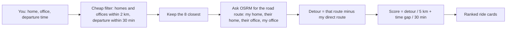
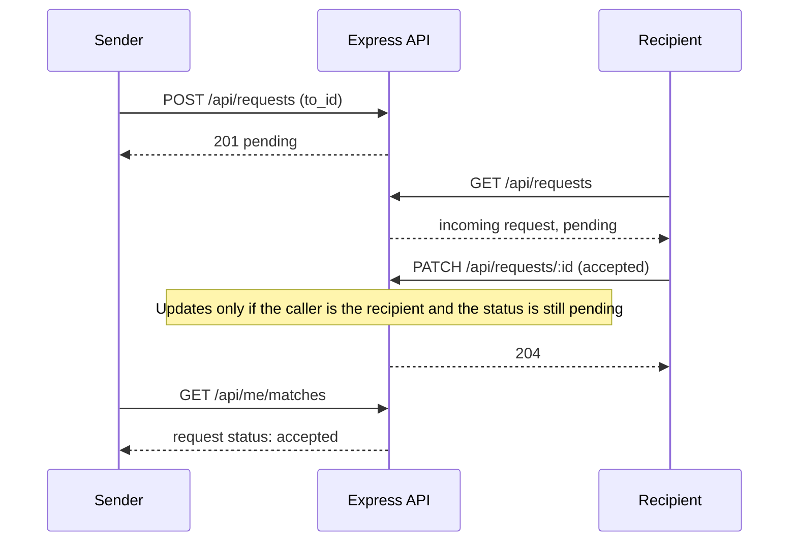
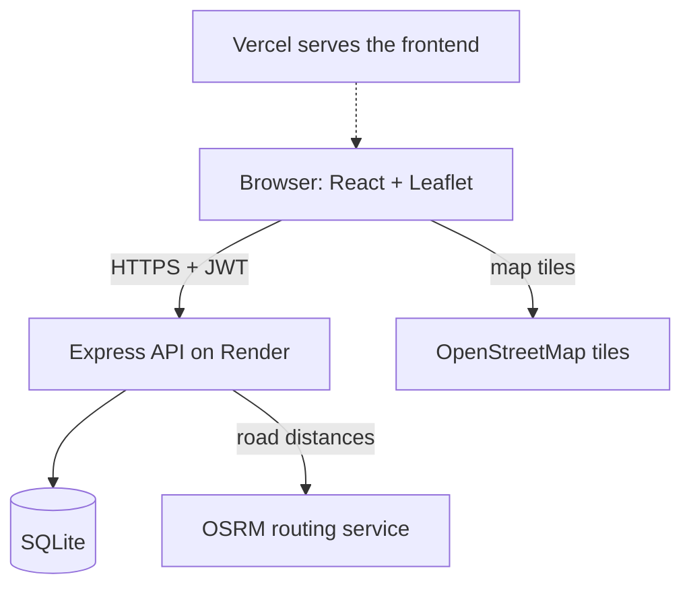

<div align="center">

# CommuteBuddy 🚗

**Find carpool buddies by detour, not just distance.**

Pin your home and office, set a departure time, and get ranked rides from coworkers whose route and timing match yours.

[](https://commutebuddy-zeta.vercel.app)
[](#-tests)
[](#-tech-stack)

[Try it](#-try-it-in-30-seconds) · [How it works](#-how-it-works) · [API](#-api-reference) · [Run locally](#-run-locally) · [Tradeoffs](#-design-decisions-and-tradeoffs) · [Roadmap](#-limitations-and-roadmap)

</div>

---

## 🎯 Why this exists

Every morning in Bengaluru, thousands of people drive the same route alone. Two people who live 1 km apart can still be a terrible match if the roads between them are slow. So instead of ranking by straight-line distance, CommuteBuddy asks one question:

> **How many extra kilometers would I drive to pick this person up and drop them off?**

It scores that detour together with how close your departure times are, and ranks the results.

---

## ⚡ Try it in 30 seconds

1. Open the **[live demo](https://commutebuddy-zeta.vercel.app)**.
2. Click **Use the demo account**, then **Log in**.
3. Click the map in **Koramangala** for your home, then in **Whitefield** for your office.
4. Click **Find rides**. The map zooms to fit your route and ride cards appear.
5. Hover a card to highlight its route. Click **Request ride**.

> ⏳ The backend runs on a free plan and sleeps when idle. **The first request can take up to a minute.** Open the [health check](https://commutebuddy-hlfo.onrender.com/api/health) first to wake it up.

<details>
<summary><b>Demo accounts</b> (all use the same password)</summary>

| Email | Password |
|---|---|
| `ravi@demo.com` | `password123` |
| `meera@demo.com` | `password123` |
| `karthik@demo.com` | `password123` |
| `divya@demo.com` | `password123` |
| `arjun@demo.com` | `password123` |
| `sneha@demo.com` | `password123` |
| `vikram@demo.com` | `password123` |

**Try the full request flow:** open two browser windows (one normal, one incognito). In the first, register your own account and request a ride from Ravi. In the second, log in as `ravi@demo.com`, open the **Requests** tab, and click **Accept**.

These accounts are public. Please don't use a real password on the demo site.

</details>

---

## ✨ Features

- [x] Click-to-pin home and office on an OpenStreetMap map
- [x] Matching by home distance, office distance and departure time
- [x] Ranking by **detour cost** using real road distances (OSRM), with a straight-line fallback
- [x] Accounts with JWT auth and bcrypt-hashed passwords
- [x] Ride requests: send, accept, decline
- [x] Booking-style UI with a responsive bottom sheet on phones
- [x] Input validation and rate limiting on the API
- [x] 17 automated API tests

---

## 🧠 How it works

### The matching pipeline



The filter uses cheap straight-line math (Haversine) so the expensive routing call only runs for a handful of candidates.

<details>
<summary><b>Worked example</b>: why the smallest detour doesn't always win</summary>

The score is `detour / 5 km + time gap / 30 min`, and lower is better. These numbers come from a real run:

| Commuter | Detour | Time gap | Detour term | Time term | Score |
|---|---|---|---|---|---|
| Meera | +2.6 km | 5 min | 0.520 | 0.167 | **0.687** |
| Karthik | +1.2 km | 20 min | 0.240 | 0.667 | **0.907** |
| Ravi | +2.9 km | 10 min | 0.580 | 0.333 | **0.913** |

Karthik has the smallest detour of the three, but he leaves 20 minutes away from you, so he ranks second. Meera wins because she is close on both. Road distances come from a live routing service, so your exact numbers will vary.

</details>

### Sending and accepting a ride request



### Architecture



---

## 🛠 Tech stack

| Layer | Choice |
|---|---|
| Frontend | React, Vite, Leaflet and react-leaflet |
| Backend | Node.js, Express |
| Database | SQLite (better-sqlite3) |
| Auth | JWT, bcrypt |
| Routing | OSRM public demo server |
| Tests | Jest, Supertest |
| Hosting | Vercel (frontend), Render (API) |

---

## 📡 API reference

Base URL (live): `https://commutebuddy-hlfo.onrender.com/api`  
Protected routes need the header `Authorization: Bearer <token>`.

| Method | Path | Auth | What it does |
|---|---|---|---|
| `GET` | `/health` | no | Health check, returns `{"ok":true}` |
| `POST` | `/register` | no | Create an account, returns `{ token }` |
| `POST` | `/login` | no | Log in, returns `{ token }` |
| `GET` | `/me` | yes | Your saved profile, or `null` |
| `PUT` | `/me/profile` | yes | Save your name, home, office and departure time |
| `GET` | `/me/matches` | yes | Ranked matches with detour, plus request status |
| `POST` | `/requests` | yes | Send a ride request (`to_id`) |
| `GET` | `/requests` | yes | Your incoming and outgoing requests |
| `PATCH` | `/requests/:id` | yes | Accept or decline (recipient only, while pending) |

<details>
<summary><b>Try it with curl</b></summary>

```bash
# 1. Log in as a demo user and capture the token
TOKEN=$(curl -s -X POST https://commutebuddy-hlfo.onrender.com/api/login \
  -H "Content-Type: application/json" \
  -d '{"email":"ravi@demo.com","password":"password123"}' | sed 's/.*"token":"\([^"]*\)".*/\1/')

# 2. Fetch your ranked matches
curl -s https://commutebuddy-hlfo.onrender.com/api/me/matches \
  -H "Authorization: Bearer $TOKEN"
```

On Windows PowerShell, use `Invoke-RestMethod` instead:

```powershell
$r = Invoke-RestMethod -Method Post -Uri https://commutebuddy-hlfo.onrender.com/api/login `
  -ContentType "application/json" -Body '{"email":"ravi@demo.com","password":"password123"}'
Invoke-RestMethod https://commutebuddy-hlfo.onrender.com/api/me/matches `
  -Headers @{ Authorization = "Bearer $($r.token)" }
```

</details>

<details>
<summary><b>Example match response</b></summary>

```json
[
  {
    "id": 3,
    "name": "Meera",
    "homeKm": 0.7,
    "officeKm": 0.2,
    "gap": 5,
    "detourKm": 2.6,
    "detourSource": "road",
    "score": 0.687,
    "home": [12.938, 77.62],
    "office": [12.972, 77.752],
    "request": null
  }
]
```

`detourSource` is `"road"` when OSRM answered, or `"estimate"` when the app fell back to straight-line distance. `request` is `null` until a request exists, then `{ id, status, direction }`.

</details>

<details>
<summary><b>Error codes and rate limits</b></summary>

| Code | Meaning |
|---|---|
| `400` | Invalid input (bad email, short password, coordinates out of range, invalid time) |
| `401` | Missing or invalid token, or wrong login |
| `404` | Commuter or request not found, or you aren't allowed to act on it |
| `409` | Email already registered, or a request already exists between two people |
| `429` | Rate limit hit |
| `500` | Unexpected server error |

**Rate limits:** login and register allow 20 attempts per 15 minutes per IP. All other API routes allow 120 requests per minute per IP.

</details>

---

## 💻 Run locally

**You need:** Node.js 22 or newer.

```bash
git clone https://github.com/naman0867/commutebuddy.git
cd commutebuddy
npm install
cd client && npm install && cd ..
```

**Terminal 1: backend** (the flag creates the demo users)

<details open>
<summary>macOS / Linux / Git Bash</summary>

```bash
SEED_DEMO=true node server.js
```

</details>

<details>
<summary>Windows PowerShell</summary>

```powershell
$env:SEED_DEMO="true"; node server.js
```

</details>

Wait for `API on :4000`.

**Terminal 2: frontend**

```bash
cd client
npm run dev
```

Open `http://localhost:5173` and use the demo account.

<details>
<summary><b>Environment variables</b></summary>

| Variable | Where | Purpose |
|---|---|---|
| `JWT_SECRET` | backend | Token signing key. **Required in production.** |
| `NODE_ENV` | backend | Set to `production` when deployed |
| `PORT` | backend | Port to listen on (defaults to 4000) |
| `FRONTEND_URL` | backend | Allowed CORS origin (any origin if unset) |
| `SEED_DEMO` | backend | `true` creates the demo users on startup |
| `DB_PATH` | backend | SQLite file path (defaults to `commute.db`) |
| `USE_OSRM` | backend | `false` turns off road routing and uses estimates |
| `VITE_API_URL` | frontend | API base URL (defaults to `http://localhost:4000/api`) |

</details>

<details>
<summary><b>Project structure</b></summary>

```
commutebuddy/
├── server.js          Express API, matching, auth, validation
├── server.test.js     17 API tests
├── seed.js            Optional standalone demo seeding
├── package.json
└── client/
    ├── public/        Static assets
    └── src/
        ├── App.jsx    Login screen, map, panel, ride cards
        ├── index.css  All styling
        └── main.jsx
```

</details>

---

## 🧪 Tests

```bash
npm test
```

17 tests run against an in-memory database, so no server needs to be running.

<details>
<summary><b>What the tests cover</b></summary>

- **Auth:** invalid email, short password, duplicate email, wrong and right password, protected routes need a token
- **Profile validation:** latitude out of range, invalid departure time, empty name, valid profile
- **Matching:** only nearby commuters with a close departure time, non-negative detour, profile required
- **Ride requests:** send, block duplicates, the sender can't accept their own request, a third user can't accept someone else's request, the recipient can accept

</details>

---

## 🔒 Security notes

- Passwords are hashed with bcrypt, never stored in plain text.
- Every request update checks that the logged-in user is the **recipient** and that the status is still pending, so guessing an ID can't act on someone else's request.
- Login and register are rate limited, and the whole API has a general limit.
- Request bodies are capped at 10 KB, and every endpoint validates its input.
- The server refuses to start in production without a `JWT_SECRET`.

---

## ⚖️ Design decisions and tradeoffs

| Decision | Why | Tradeoff |
|---|---|---|
| Rank by **detour**, not straight-line distance | It measures what a driver actually gives up | Needs a routing service, which adds latency and cost |
| **Cheap filter first**, route only the top 8 | Keeps routing calls to a handful per search | A good match outside the 2 km filter is never considered |
| **Fallback to estimates** if routing fails | The app still works when OSRM is slow or down | Estimates are less accurate, so the UI labels them |
| **SQLite** | Zero setup, one file, fast for a prototype | One server only, and free hosts reset the file |
| **JWT in localStorage** | Simple to build and easy to demo | Exposed to XSS. Production would use httpOnly cookies. |
| Detour is calculated as if **you drive** | Keeps the model simple | The other person might be the better driver |

---

## 🚧 Limitations and roadmap

- [x] Matching engine, map UI, auth, requests, tests, deployment
- [ ] **Postgres + PostGIS** with a spatial index, replacing the full scan
- [ ] **Self-hosted or paid routing**, with cached and precomputed routes (the public OSRM demo server isn't for production)
- [ ] **Recurring weekly schedules** instead of a single departure time
- [ ] **Either person can drive**, picking the cheaper option
- [ ] **Work-email verification, ratings and an emergency contact** for trust and safety
- [ ] **Notifications** for new and accepted requests
- [ ] **Paid map tiles** (the public OpenStreetMap server is fine for a demo, not heavy traffic)
- [ ] **Redis** for rate limiting and caching across multiple servers

Carpooling lives or dies on **density**: it only works when enough people nearby use it. A real launch would start inside a single employer or tech park, where identity is verifiable and users are close together.

---

## 🤝 Contributing

Issues and pull requests are welcome. Run `npm test` before opening a PR.

## 👋 Author

Built by **Naman Kumar**. Feedback is very welcome: [LinkedIn](https://www.linkedin.com/in/namankumar001/) · [GitHub](https://github.com/naman0867)

<div align="center">

If this was useful, a ⭐ helps others find it.

</div>